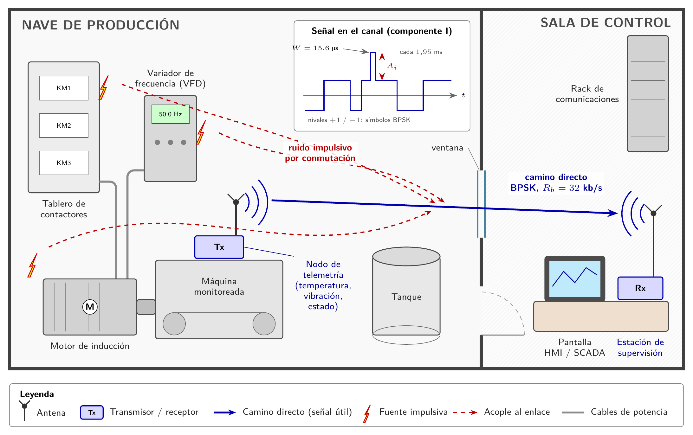
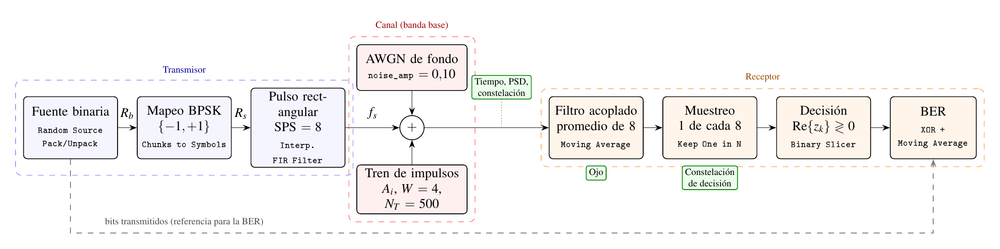

# Telemetría industrial bajo perturbaciones impulsivas

**Proyecto Integrador de Comunicaciones II (27145) — Escenario S1 — Grupo 03**
Universidad Industrial de Santander, Escuela E3T

## Integrantes

- Luis Miguel Higuera Ortiz
- Valeria Rueda Luna
- Maryuri Dayana Sanchez Sanchez
- Jhoan Sebastian Vega Martinez

## Resumen

Se simuló en banda base un enlace de telemetría industrial de baja velocidad afectado por perturbaciones impulsivas como las que generan motores, contactores y variadores. El sistema usa BPSK con pulso rectangular y un receptor con filtro acoplado. Sobre la señal se sumó un tren periódico de impulsos cuya amplitud fue la única variable, en una condición de referencia y tres niveles de severidad. No hubo errores mientras la amplitud efectiva del impulso, diluida por el filtro acoplado, fue menor que la del símbolo. Por encima de ese umbral, la BER alcanzó un piso de 1,1 × 10⁻² que no dependió de la amplitud y que el modelo analítico reprodujo. La PSD no mostró cambios apreciables. Como prueba complementaria, se transmitió 16QAM entre dos HackRF One en el laboratorio.



## Parámetros del sistema

| Parámetro | Valor |
|---|---|
| Modulación | BPSK (M = 2, k = 1 bit/símbolo) |
| Tasa de símbolos, Rs | 32 ksym/s |
| Tasa de bits, Rb | 32 kb/s |
| Muestras por símbolo, SPS | 8 |
| Frecuencia de muestreo, fs | 256 kS/s |
| Pulso y ancho de banda | Rectangular, ≈ 64 kHz entre primeros nulos |
| Perturbación | Tren periódico de impulsos: W = 4 muestras (15,6 µs), N_T = 500 muestras (1,953 ms), amplitud A_imp variable |
| Ruido de fondo | AWGN fijo, `noise_amp = 0.10` |
| Receptor | Filtro acoplado (promedio de 8 muestras), muestreo 1 de 8, decisión por signo |



## Archivo GRC principal y cómo ejecutarlo

- **Archivo principal:** `grc/archivos_modificados/S1_BPSK_Ruido_Impulsivo_Grupo3.grc`
- **Archivos de referencia (sin modificar):** `grc/archivos_de_referencia/`

Pasos:
1. Abrir el archivo en GNU Radio Companion 3.10.
2. Ejecutar con **F6** (o el botón ▶).
3. En la ventana de la simulación, ajustar **`A_imp`** al valor de la prueba (0; 1,0; 2,0 o 4,0).
4. Esperar al menos **5 s** antes de leer la BER: la ventana de promedio es de 10⁵ bits (≈ 3,1 s).
5. Con `A_imp = 0`, la BER debe ser 0. Si marca cerca de 0,5, ajustar `retardo_bits`.

Bloques agregados respecto al archivo de referencia: `Vector Source` y `Multiply Const` (tren de impulsos), `Add` de tres entradas, `Moving Average` (filtro acoplado), `QT GUI Eye Sink`, `Keep 1 in N`, `Complex to Real`, `Binary Slicer`, `XOR`, `Char To Float`, `Moving Average` (BER) y `QT GUI Number Sink`. La tabla de constelación se cambió de OOK `(0, 1)` a BPSK `(-1, 1)`.

## Tabla de pruebas

| Prueba | Severidad | A_imp | Amplitud efectiva A_ef | BER medida |
|---|---|---|---|---|
| A | Referencia | 0 | 0 | sin errores en 10⁵ bits |
| B | Suave | 1,0 | 0,5 | sin errores en 10⁵ bits |
| C | Media | 2,0 | 1,0 | 5,82 × 10⁻³ |
| D | Fuerte | 4,0 | 2,0 | 1,10 × 10⁻² |

Datos completos, con 13 amplitudes y los valores teóricos: `data/tablas_de_pruebas/`.

## Conclusión principal

La degradación por ruido impulsivo tiene un comportamiento de **umbral**. El enlace no presentó errores mientras la amplitud efectiva del impulso (A_imp·W/SPS) fue menor que la del símbolo, es decir, hasta A_imp ≈ 2. Por encima de ese umbral, la BER se estabilizó en un piso que depende de la fracción de símbolos alcanzados y no de la relación señal a ruido. La PSD, una medida promediada, no basta para diagnosticar este tipo de perturbación.

## Estructura del repositorio

```
ComunicacionesII_Grupo03/
├── README.md
├── grc/
│   ├── archivos_originales_o_referencia/   flujogramas del curso, sin modificar
│   └── archivos_modificados/               flujograma del escenario S1
├── figures/
│   ├── escenario/                          imagen contextual (Fig. 1)
│   ├── psd/                                PSD de las pruebas A–D
│   ├── constelacion_o_fsk/                 constelaciones de decisión y sobremuestreadas
│   ├── diagramas_tecnicos/                 diagrama de bloques y capturas de los GRC
│   ├── senal_temporal/                     señal en el canal, pruebas A–D
│   ├── diagrama_ojo/                       diagramas de ojo, pruebas A–D
│   └── hardware_sdr/                       prueba 16QAM con HackRF One
├── data/
│   └── tablas_de_pruebas/                  parámetros, plan de pruebas y BER
├── docs/
│   ├── informe_final.pdf
│   ├── informe_latex/                      fuente LaTeX del informe (Overleaf)
│   ├── ficha_decision_tecnica.pdf
│   ├── bitacora.md
│   └── guion_video_socializacion.md
└── referencias/
    └── fuentes_y_enlaces.md
```

## Uso de herramientas de IA

Se utilizó un asistente de IA (Claude, de Anthropic) para apoyar la búsqueda de referencias, la redacción, la construcción del flujograma modificado y la elaboración de la imagen del escenario y del diagrama de bloques. Las simulaciones las ejecutó el equipo, que revisó y validó los parámetros, resultados y conclusiones.

---

_Última actualización: 9 de noviembre de 2026_
